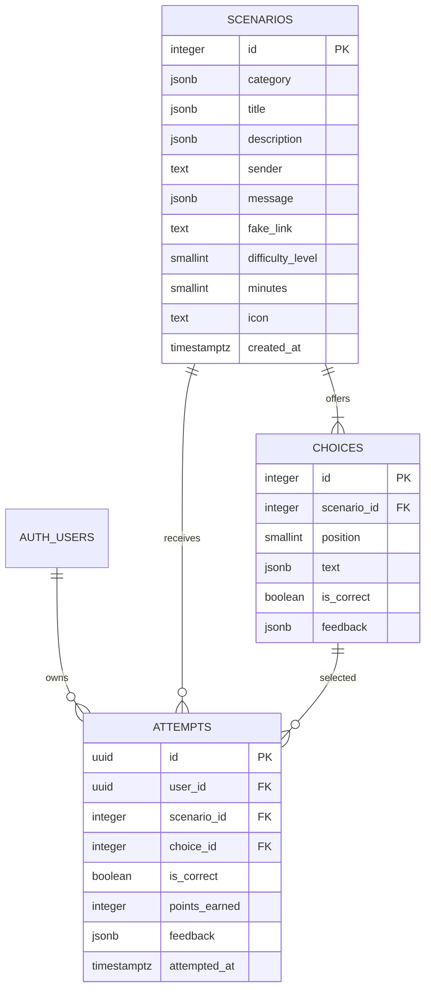

# Актуална ER диаграма — Етап 2

Три приложни таблици плюс системната auth.users. JSONB съдържа bg/en. Допълнителни ограничения: UNIQUE(user_id, scenario_id) в attempts; UNIQUE(scenario_id, position) и UNIQUE(id, scenario_id) в choices; съставен FK attempts(choice_id,scenario_id) → choices(id,scenario_id). Системната auth.users не се създава от schema.sql.

Схемата е проектен артефакт, а не експорт от вече създаден Supabase проект. За действителния експорт изпълнете verify.sql след настройката. Обосновка за отложените profiles/progress: PROJECT_PLAN.md.
